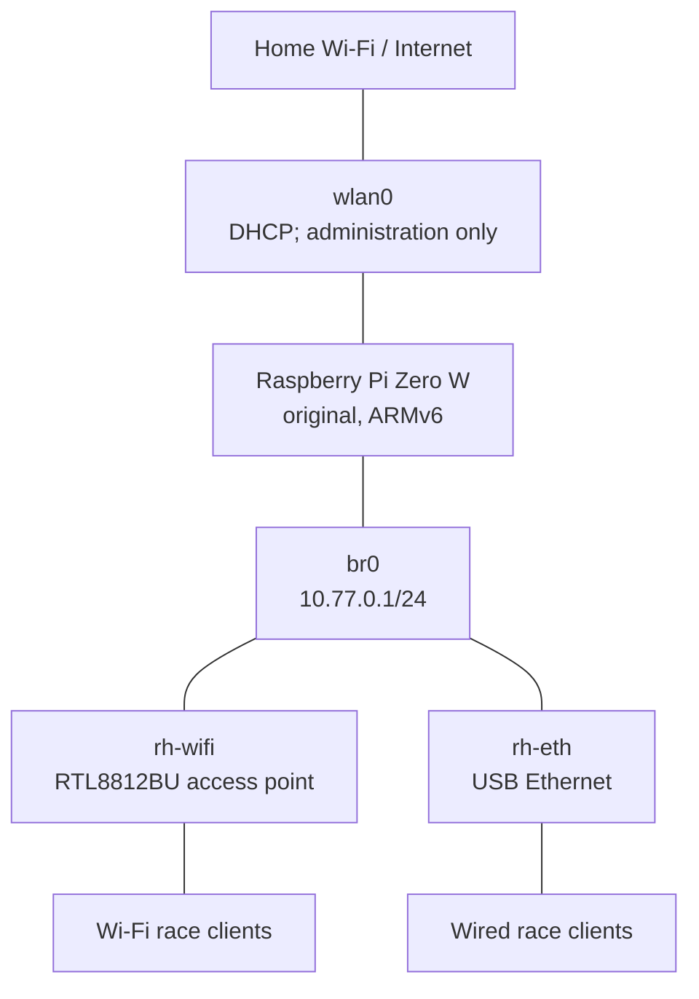

# Wifi access point and RotorHazard server on a Raspberry Pi Zero W

This runbook builds a headless [RotorHazard](https://github.com/RotorHazard/RotorHazard) server. The built-in Wi-Fi joins the home network for administration; USB Wi-Fi and Ethernet provide an isolated race LAN; a [widscan58](https://github.com/CapnBry/widscan58/blob/main/docs/RotorHazard.md) timer connects over USB serial.



Race clients receive `10.77.0.x/24` addresses with no gateway and reach RotorHazard at `http://10.77.0.1:5000` or `http://rotorhazard.lan:5000`.

> [!IMPORTANT]
> This guide targets the **original, single-core Raspberry Pi Zero W (ARMv6)** and 32-bit Raspberry Pi OS Lite (Bookworm). RotorHazard recommends a Pi 3 or newer, so build and load-test this lower-powered setup before an event.

## 1. Hardware and values to choose

You need an original Pi Zero W, suitable power supply, microSD card, powered USB OTG hub, RTL8812BU adapter, USB Ethernet adapter, and a widscan58 timer with a data-capable cable. Use a powered hub because the three USB devices can exceed the Pi's power budget.

Choose and substitute these values throughout:

| Setting | Example used here |
|---|---|
| Pi user | `rhadmin` |
| Pi hostname | `rotorhazard` |
| Wi-Fi country | `CN` |
| Home Wi-Fi SSID | `MyHomeWiFi` |
| Race AP SSID | `RotorHazard` |
| Race subnet | `10.77.0.0/24` |
| Pi race address | `10.77.0.1` |

Use strong passwords. The Pi-user password is for the local console and `sudo`; SSH will be key-only.

## 2. Flash the SD card and configure first-boot Wi-Fi

On the Ubuntu computer, install Raspberry Pi Imager (use the [official package](https://www.raspberrypi.com/software/) if Ubuntu does not provide it):

```bash
sudo apt update
sudo apt install rpi-imager openssl
```

Create and back up a passphrase-protected administration key:

```bash
if [ ! -e "$HOME/.ssh/rotorhazard_ed25519" ]; then
  ssh-keygen -t ed25519 -a 100 -f "$HOME/.ssh/rotorhazard_ed25519" -C rotorhazard-admin
fi
cat "$HOME/.ssh/rotorhazard_ed25519.pub"
rpi-imager
```

Write **Raspberry Pi OS Lite (32-bit)**; the ARMv6 Pi Zero W cannot boot the 64-bit image.

### Manual SD-card configuration instead of Imager customisation

Insert the freshly imaged card and identify it by size and model:

```bash
lsblk -p -o NAME,SIZE,FSTYPE,LABEL,MOUNTPOINTS,MODEL
```

Use the actual card partitions—never guess. Built-in readers commonly use `/dev/mmcblk0p1` and `/dev/mmcblk0p2`. Unmount any automatically mounted partitions before continuing.

```bash
sudo mkdir -p /mnt/rh-boot /mnt/rh-root
sudo mount /dev/mmcblk0p1 /mnt/rh-boot
sudo mount /dev/mmcblk0p2 /mnt/rh-root
```

Enable SSH and generate a password hash interactively so the plaintext password is not stored in shell history:

```bash
sudo touch /mnt/rh-boot/ssh
openssl passwd -6
```

Save the following single line as `/mnt/rh-boot/userconf.txt`, replacing the entire hash:

```text
rhadmin:$6$REPLACE_WITH_THE_COMPLETE_HASH
```

Install the public key for the first user (UID/GID 1000):

```bash
sudo install -d -m 700 -o 1000 -g 1000 /mnt/rh-root/home/rhadmin/.ssh
sudo install -m 600 -o 1000 -g 1000 \
  "$HOME/.ssh/rotorhazard_ed25519.pub" \
  /mnt/rh-root/home/rhadmin/.ssh/authorized_keys
```

Create `/mnt/rh-root/etc/ssh/sshd_config.d/10-key-only.conf`:

```sshconfig
PubkeyAuthentication yes
AuthenticationMethods publickey
PasswordAuthentication no
KbdInteractiveAuthentication no
ChallengeResponseAuthentication no
PermitRootLogin no
```

Do not add `ListenAddress`; SSH must listen on all interfaces.

```bash
sync
sudo umount /mnt/rh-boot /mnt/rh-root
```

Use the USB Ethernet adapter temporarily as a home-router DHCP client:

1. Connect the USB Ethernet adapter to a LAN port on the home router.
2. Boot the Pi and find its new wired address in the router's DHCP leases.
3. Connect from Ubuntu using the provisioned key:

   ```bash
   ssh -i ~/.ssh/rotorhazard_ed25519 rhadmin@WIRED_IP_FROM_ROUTER
   ```

4. On the Pi, create the home Wi-Fi connection. `--ask` keeps its password out of shell history:

   ```bash
   sudo raspi-config nonint do_wifi_country CN
   sudo rfkill unblock wifi
   sudo nmcli radio wifi on
   sudo nmcli device wifi rescan ifname wlan0
   nmcli device wifi list ifname wlan0
   #sudo nmcli connection delete home-wifi 2>/dev/null || true
   sudo nmcli --ask device wifi connect 'EXACT_HOME_SSID' \
     ifname wlan0 name home-wifi
   sudo nmcli connection modify home-wifi \
     connection.autoconnect yes \
     connection.autoconnect-priority 100 \
     connection.autoconnect-retries 0 \
     connection.interface-name wlan0
   ```

   For a hidden SSID, add `hidden yes` to the final command.

5. Confirm that `wlan0` has a home-network address:

   ```bash
   nmcli device status
   nmcli -f GENERAL.STATE,GENERAL.CONNECTION,IP4.ADDRESS device show wlan0
   ip route
   ```
## 3. First boot and base setup

Insert the card, connect the powered hub and power, find `rotorhazard.local` or its lease in the home router, and log in:

```bash
ssh -i ~/.ssh/rotorhazard_ed25519 rhadmin@rotorhazard.local
```

Confirm that the image reports `armv6l` and `32`:

```bash
uname -m
getconf LONG_BIT
```

Update and install packages:

```bash
sudo apt update
sudo apt install screen
screen -R
sudo apt full-upgrade -y
sudo hostnamectl set-hostname rotorhazard
sudo timedatectl set-timezone Asia/Shanghai
sudo raspi-config nonint do_wifi_country CN
sudo apt install -y \
  hostapd dnsmasq avahi-daemon iw rfkill firmware-realtek ethtool \
  python3-dev python3-venv libffi-dev python3-smbus build-essential \
  python3-pip git scons swig python3-rpi.gpio wget
sudo systemctl enable --now avahi-daemon
sudo reboot
```

Add `rotorhazard` to the `127.0.0.1` line in `/etc/hosts` with `sudo nano /etc/hosts`.

Reconnect over SSH after the reboot.

### Verify key-only SSH

```bash
sudo sshd -T | grep -E '^(authenticationmethods|pubkeyauthentication|passwordauthentication|kbdinteractiveauthentication|permitrootlogin) '
sudo ss -lntp | grep -E 'LISTEN.+:22[[:space:]]'
```

A password-only attempt should fail:

```bash
ssh -o PubkeyAuthentication=no \
  -o PreferredAuthentications=password,keyboard-interactive \
  rhadmin@rotorhazard.local
```

## 4. Install or verify the RTL8812BU driver

Connect the RTL8812BU Wi-Fi and USB Ethernet adapters to the powered hub. Do not connect a race-side Ethernet cable yet.

```bash
ip -br link
iw dev
lsusb -nn
uname -r
sudo dmesg | grep -Ei 'rtw|88x2bu|8812|8822|firmware|usb'
```

The built-in radio is normally `wlan0`; USB adapters may initially use `wlan1`, `wlx...`, `eth0`, or `enx...`.

### Prefer the in-kernel driver

Kernels 6.12 and newer normally include `rtw88`. Check the bound driver, substituting the temporary interface name:

```bash
sudo ethtool -i wlan1
lsmod | grep -E 'rtw_8822bu|rtw88|88x2bu'
```

If it reports `rtw_8822bu`, keep it. Find the adapter's `phy#` with `iw dev` and confirm AP mode:

```bash
iw phy phy1 info | sed -n '/Supported interface modes:/,/Band /p'
```

If the output contains `* AP`, skip the fallback.

### Fallback for a missing or unusable in-kernel driver

Use this only when the adapter has no interface, bound driver, or AP mode. Remove any existing third-party RTL8812BU driver first; never install competing drivers.

```bash
sudo apt install -y raspberrypi-kernel-headers build-essential bc dkms git
mkdir -p ~/src
cd ~/src
git clone https://github.com/morrownr/88x2bu-20210702.git
cd 88x2bu-20210702
sudo sh install-driver.sh NoPrompt
sudo reboot
```

After reboot, repeat the checks above. Compilation is slow on the Pi Zero W. Keep the cloned directory for driver upgrades and removal. If the adapter remains missing, inspect `journalctl -k -b`.

## 5. Identify and give the USB adapters stable names

Record permanent MAC addresses, substituting the actual temporary interface names:

```bash
cat /sys/class/net/wlan1/address
cat /sys/class/net/eth0/address
```

Create `/etc/systemd/network/10-rh-wifi.link` with the RTL8812BU MAC:

```ini
[Match]
MACAddress=AA:BB:CC:DD:EE:FF

[Link]
Name=rh-wifi
```

Create `/etc/systemd/network/11-rh-eth.link` with the USB Ethernet MAC:

```ini
[Match]
MACAddress=11:22:33:44:55:66

[Link]
Name=rh-eth
```

Create both files, replace the example MACs, and reboot:

```bash
sudo nano /etc/systemd/network/10-rh-wifi.link
sudo nano /etc/systemd/network/11-rh-eth.link
sudo reboot
```

Run `ip -br link`; continue only when the devices are `rh-wifi`, `rh-eth`, and `wlan0`.

## 6. Build the race-LAN bridge

NetworkManager owns the bridge and wired port; hostapd owns `rh-wifi`.

`sudo nano /etc/NetworkManager/conf.d/20-rh-ap-unmanaged.conf`:

```ini
[keyfile]
unmanaged-devices=interface-name:rh-wifi
```

Create `br0`, give it the static race address, and attach USB Ethernet:

```bash
sudo systemctl reload NetworkManager

sudo nmcli connection add type bridge ifname br0 con-name rh-bridge
sudo nmcli connection modify rh-bridge \
  ipv4.method manual ipv4.addresses 10.77.0.1/24 \
  ipv4.gateway "" ipv4.never-default yes \
  ipv6.method disabled \
  bridge.stp no connection.autoconnect yes

sudo nmcli connection add type ethernet ifname rh-eth con-name rh-ethernet \
  master br0 slave-type bridge

sudo nmcli connection up rh-bridge
sudo nmcli connection up rh-ethernet
ip -br address | grep -E '^(br0|rh-eth)[[:space:]]'
```

`br0` should show `10.77.0.1/24`; `rh-eth` should not have its own address.

## 7. Configure the RTL8812BU access point

`sudo nano /etc/hostapd/hostapd.conf`, replacing country, SSID, and passphrase:

```ini
country_code=CN
interface=rh-wifi
bridge=br0
driver=nl80211

ssid=RotorHazard
hw_mode=g
channel=6
ieee80211n=1
wmm_enabled=1
auth_algs=1
ignore_broadcast_ssid=0

wpa=2
wpa_key_mgmt=WPA-PSK
rsn_pairwise=CCMP
wpa_passphrase=REPLACE_WITH_A_STRONG_RACE_PASSWORD

# No max_num_sta setting: hostapd applies no administrator-configured client cap.
```

Use 2.4 GHz for compatibility. Choose channel 1, 6, or 11 after running `sudo iw dev wlan0 scan`.

```bash
sudo nano /etc/hostapd/hostapd.conf
sudo sed -i 's|^#\?DAEMON_CONF=.*|DAEMON_CONF="/etc/hostapd/hostapd.conf"|' /etc/default/hostapd
sudo rfkill unblock wifi
sudo systemctl unmask hostapd
sudo systemctl enable --now hostapd

systemctl --no-pager --full status hostapd
bridge link
iw dev rh-wifi info
iw dev rh-wifi station dump | grep -c '^Station '
```

### Set maximum permitted AP transmit power

Inspect the regulatory and adapter limits (`2000` mBm equals `20` dBm):

```bash
iw reg get
iw dev rh-wifi info
iw phy "$(iw dev rh-wifi info | awk '/wiphy/ {print "phy" $2}')" info | \
  sed -n '/Frequencies:/,/valid interface combinations:/p'
```

Request 20 dBm and inspect the effective value:

```bash
sudo iw dev rh-wifi set txpower fixed 2000
iw dev rh-wifi info
```

Use no more than the displayed country/channel limit. The system may clamp the request; do not bypass its regulatory controls.

Create `/etc/systemd/system/rh-wifi-txpower.service` with `sudo nano`:

```ini
[Unit]
Description=Set RotorHazard AP transmit power to the permitted maximum
Requires=hostapd.service
After=hostapd.service

[Service]
Type=oneshot
ExecStart=/usr/sbin/iw dev rh-wifi set txpower fixed 2000
RemainAfterExit=yes

[Install]
WantedBy=multi-user.target
```

Enable and verify it:

```bash
sudo systemctl daemon-reload
sudo systemctl enable --now rh-wifi-txpower.service
systemctl --no-pager --full status rh-wifi-txpower.service
iw dev rh-wifi info
```

If the service reports `Invalid argument` or `Operation not supported`, replace `ExecStart` with:

```ini
ExecStart=/usr/sbin/iw dev rh-wifi set txpower auto
```

```bash
sudo systemctl daemon-reload
sudo systemctl restart rh-wifi-txpower.service
```

## 8. Configure DHCP and local DNS with no default route

Create `/etc/dnsmasq.d/rotorhazard.conf` with `sudo nano`:

```ini
# Serve only the isolated race bridge.
interface=br0
bind-dynamic
dhcp-authoritative

dhcp-range=10.77.0.2,10.77.0.254,255.255.255.0,12h

# Empty by design: clients receive no default gateway.
dhcp-option=option:router

# Answer only for the race name; do not relay Internet DNS.
dhcp-option=option:dns-server,10.77.0.1
no-resolv
domain-needed
bogus-priv
local=/rotorhazard.lan/
host-record=rotorhazard.lan,10.77.0.1
```

Validate and enable dnsmasq:

```bash
sudo dnsmasq --test
sudo systemctl enable --now dnsmasq
systemctl --no-pager --full status dnsmasq
```

Create `/etc/sysctl.d/90-rotorhazard-isolation.conf` with `sudo nano`:

```ini
net.ipv4.ip_forward=0
net.ipv6.conf.all.forwarding=0
```

```bash
sudo sysctl --system
sysctl net.ipv4.ip_forward net.ipv6.conf.all.forwarding
```

Test both Wi-Fi and Ethernet clients. Each must receive `10.77.0.x/24`, reach `10.77.0.1`, and have no default route:

```bash
ip address
ip route
ping -c 3 10.77.0.1
```

“No Internet” is expected; keep the client connected.

### Verify SSH over both race interfaces

From Ubuntu, connect to the race Wi-Fi and test SSH:

```bash
ssh -o PasswordAuthentication=no \
  -i ~/.ssh/rotorhazard_ed25519 \
  rhadmin@10.77.0.1
```

Then disconnect Wi-Fi, connect through `rh-eth` using automatic DHCP, and repeat:

```bash
ip -br address
ssh -o PasswordAuthentication=no \
  -i ~/.ssh/rotorhazard_ed25519 \
  rhadmin@10.77.0.1
```

Both paths use `10.77.0.1` and the same SSH host key. After verifying DNS, `rotorhazard.lan` also works.

## 9. Prepare the widscan58 timer

Follow the widscan58 RotorHazard instructions before attaching it:

1. Flash the board at <https://capnbry.github.io/widscan58/>.
2. Connect, select **RotorHazard mode**, configure receiver gain/level/filter, and click **Save**.
3. Click **Disconnect** so the browser releases the serial port.
4. Connect its native USB port to the Pi's powered hub.

Add the RotorHazard user to the serial group and find the persistent link:

```bash
sudo usermod -aG dialout "$USER"
find /dev/serial/by-id -maxdepth 1 -type l -print 2>/dev/null
readlink -f /dev/serial/by-id/*
```

Use `/dev/serial/by-id/...` later, not `/dev/ttyACM0`, because the latter can change. Log out and back in (or reboot) for `dialout` membership to take effect.

This timer uses USB serial; do **not** enable the GPIO serial console or add UART overlays meant for a GPIO-connected RotorHazard node.

## 10. Install RotorHazard

Clone the source code directly from GitHub. Use a stable release tag rather than the `main` branch, which contains development code. The current stable release used by this runbook is `v4.5.0`:

```bash
cd ~
python3 --version
python3 -m venv --system-site-packages ~/.venv
~/.venv/bin/python -m pip install --upgrade pip setuptools wheel

git clone --depth 1 --branch v4.5.0 \
  https://github.com/RotorHazard/RotorHazard.git \
  ~/RotorHazard

~/.venv/bin/python -m pip install --upgrade --no-cache-dir \
  -r ~/RotorHazard/src/server/requirements.txt

mkdir -p ~/rh-data
git -C ~/RotorHazard describe --tags --exact-match
```

The version check must print `v4.5.0`. RotorHazard requires Python 3.10 or newer. Dependency installation can take a long time on the single-core ARMv6 Pi Zero W because packages without compatible binary wheels must compile locally; keep the Pi powered and do not interrupt it.

The commands invoke the virtual environment's Python explicitly, so shell activation is optional. If preferred, activate it with `source ~/.venv/bin/activate`. The systemd service below also invokes its Python executable directly.

Test it interactively before creating a service:

```bash
cd ~/RotorHazard/src/server
~/.venv/bin/python server.py
```

From a race client, open `http://10.77.0.1:5000`, complete first-run administrator setup, then stop the test server with `Ctrl-C`.

### Configure the USB timer

Open **Advanced Settings → Hardware → Serial Ports** and enter a JSON list containing the exact stable path found above, for example:

```json
["/dev/serial/by-id/usb-Espressif_USB_JTAG_serial_debug_unit_123456-if00"]
```

Save and restart RotorHazard. It should discover eight nodes. Receiver gain and filter settings remain configured in the widscan58 UI.

If the web setting is unavailable, stop RotorHazard, edit `~/rh-data/config.json`, and set `GENERAL.SERIAL_PORTS` to that list. Never edit `config.json` while RotorHazard is running because the server can overwrite it.

## 11. Start RotorHazard automatically

Run this while logged in as the user that installed RotorHazard:

```bash
RH_USER="$(id -un)"
RH_HOME="$(getent passwd "$RH_USER" | cut -d: -f6)"

sudo tee /etc/systemd/system/rotorhazard.service >/dev/null <<EOF
[Unit]
Description=RotorHazard Server
Wants=network-online.target
After=network-online.target hostapd.service dnsmasq.service

[Service]
Type=simple
User=${RH_USER}
Group=${RH_USER}
SupplementaryGroups=dialout
WorkingDirectory=${RH_HOME}/RotorHazard/src/server
ExecStart=${RH_HOME}/.venv/bin/python server.py
Restart=on-failure
RestartSec=5

[Install]
WantedBy=multi-user.target
EOF

sudo systemctl daemon-reload
sudo systemctl enable --now rotorhazard.service
systemctl --no-pager --full status rotorhazard.service
```

Reboot once, then perform the acceptance test:

```bash
sudo reboot
```

Confirm:

1. `RotorHazard` Wi-Fi is visible and accepts the WPA2 password.
2. Wi-Fi and wired race clients get `10.77.0.x/24` with no gateway.
3. Both open `http://10.77.0.1:5000` and `http://rotorhazard.lan:5000`.
4. `systemctl is-active hostapd rh-wifi-txpower dnsmasq rotorhazard` prints `active` four times.
5. `bridge link` shows `rh-wifi` and `rh-eth` on `br0`.
6. RotorHazard shows eight timer nodes and live levels.
7. Key-only SSH works from the Ubuntu host over race Wi-Fi and race Ethernet at `10.77.0.1`.
8. Home Wi-Fi remains usable for key-only SSH, but race clients cannot reach it or the Internet.
9. An SSH password-only attempt is rejected on every interface.
10. `iw dev rh-wifi info` shows the effective transmit power permitted by the driver and regulatory domain.

## Troubleshooting

```bash
ip -br address
ip route
bridge link
nmcli device status
iw dev
rfkill list
systemctl --no-pager --full status hostapd rh-wifi-txpower dnsmasq rotorhazard
journalctl -b -u hostapd -u rh-wifi-txpower -u dnsmasq -u rotorhazard --no-pager
journalctl -k -b --no-pager | grep -Ei 'rtw|88x2bu|8812|8822|firmware|usb|under.?voltage'
```

- **`hostapd` says the interface is busy:** `rh-wifi` must be unmanaged in `nmcli device status`; restart NetworkManager and hostapd after fixing it.
- **Clients get no lease:** confirm `br0` owns `10.77.0.1/24`, both ports appear in `bridge link`, and `sudo dnsmasq --test` succeeds.
- **Wired client gets a home-router address:** the USB Ethernet adapter is not attached to `br0`, or the cable is connected to the wrong adapter.
- **Race client has a default route:** renew its lease and inspect the dnsmasq file; the empty `option:router` is required.
- **RTL8812BU disappears or resets:** use a powered hub and better power supply/cable; check the kernel journal.
- **RTL8812BU has no interface or AP mode:** check `ethtool -i`, `lsmod`, and `iw phy`; install the fallback driver only if the in-kernel driver is unavailable or unusable.
- **Wi-Fi works until a kernel upgrade:** check `dkms status`. This concern applies to the fallback `88x2bu` driver, not the in-kernel `rtw88` driver.
- **Transmit-power service fails:** compare `iw reg get`, the channel limit in `iw phy ... info`, and `journalctl -u rh-wifi-txpower`; use `txpower auto` if the driver rejects a fixed setting.
- **SSH key is rejected:** on a local console, check `namei -l /home/rhadmin/.ssh/authorized_keys`, `journalctl -u ssh`, and `sudo sshd -T`; the directory must be mode `700`, the file mode `600`, and both owned by `rhadmin`.
- **SSH works through home Wi-Fi but not the AP/Ethernet:** confirm `10.77.0.1/24` is on `br0`, port 22 listens on `0.0.0.0` or `[::]`, and no `ListenAddress` restricts sshd.
- **Timer permission denied:** check `groups`, `ls -l /dev/serial/by-id/...`, and `SupplementaryGroups=dialout`.
- **Timer path is missing:** verify the cable carries data and the widscan58 browser flasher has disconnected.

Follow logs with `journalctl -f -u rotorhazard`, `journalctl -f -u hostapd`, or `journalctl -f -u dnsmasq`.

Always shut down cleanly before removing power:

```bash
sudo shutdown now
```

## Updating RotorHazard

Check the [RotorHazard releases](https://github.com/RotorHazard/RotorHazard/releases), read the release notes, and choose an exact stable tag. Do not update from `main`. The example below uses `v4.5.0`; replace it with the newer stable tag when one exists.

First back up the data directory and confirm that the source checkout has no local modifications:

```bash
sudo systemctl stop rotorhazard
cp -a ~/rh-data "$HOME/rh-data.backup.$(date +%Y%m%d-%H%M%S)"
git -C ~/RotorHazard status --short
```

The `git status` command must produce no output. If it shows changes, preserve or resolve them before continuing. Then fetch and check out the selected release and update its dependencies:

```bash
RH_VERSION=v4.5.0
cd ~/RotorHazard
git fetch --depth 1 origin tag "$RH_VERSION"
git checkout --detach "$RH_VERSION"

~/.venv/bin/python -m pip install --upgrade --no-cache-dir \
  -r ~/RotorHazard/src/server/requirements.txt

git describe --tags --exact-match
sudo systemctl start rotorhazard
systemctl --no-pager --full status rotorhazard
```

The version check must print the selected tag. Do not update immediately before an event; allow time for an ARMv6 dependency build and a complete functional test.

## References

- [RotorHazard software setup](https://github.com/RotorHazard/RotorHazard/blob/main/doc/Software%20Setup.md)
- [RotorHazard releases](https://github.com/RotorHazard/RotorHazard/releases)
- [widscan58 as a RotorHazard timer node](https://github.com/CapnBry/widscan58/blob/main/docs/RotorHazard.md)
- [Raspberry Pi headless setup](https://www.raspberrypi.com/documentation/computers/getting-started.html#setting-up-your-raspberry-pi)
- [Raspberry Pi OS Bookworm networking changes](https://www.raspberrypi.com/news/bookworm-the-new-version-of-raspberry-pi-os/)
- [RTL8812BU/RTL8822BU Linux driver guidance](https://github.com/morrownr/88x2bu-20210702)
