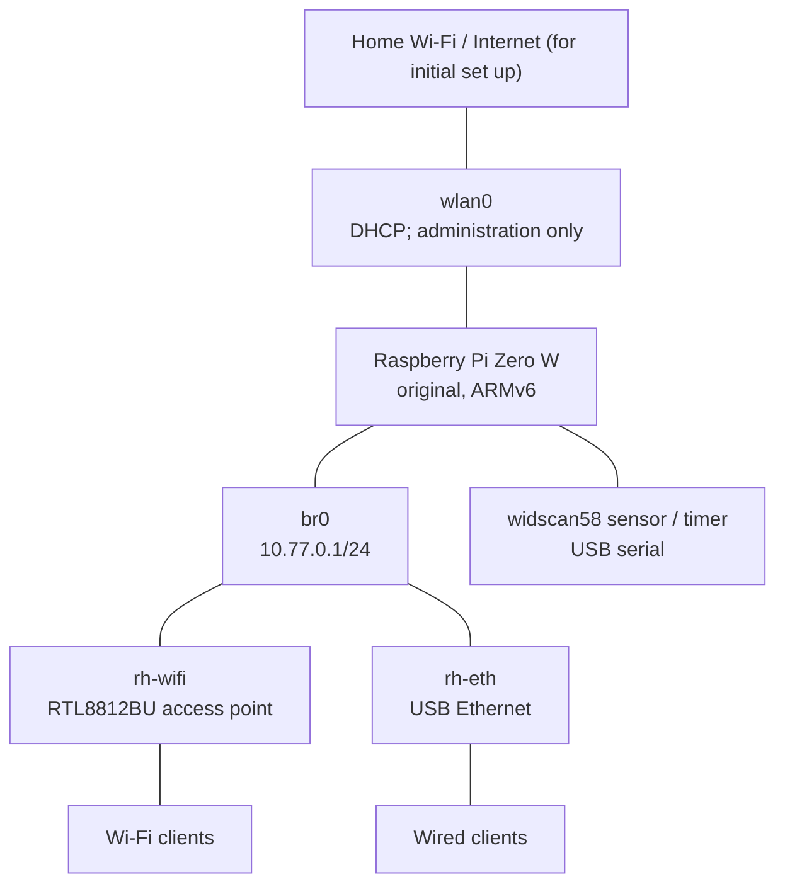

# RotorHazard server on a Raspberry Pi Zero W (Wifi AP + eth)

This runbook (for Ubuntu) builds a headless [RotorHazard](https://github.com/RotorHazard/RotorHazard) server. The built-in Wi-Fi joins the home network for initial setup and administration; USB Wi-Fi and Ethernet provide an isolated race LAN; a [widscan58](https://github.com/CapnBry/widscan58/blob/main/docs/RotorHazard.md) timer connects over USB serial.



Clients receive `10.77.0.x/24` addresses with no gateway and reach RotorHazard at `http://10.77.0.1:5000` or `http://rotorhazard.lan:5000`.

> [!IMPORTANT]
> This guide targets the **Raspberry Pi Zero W (ARMv6)** and 32-bit Raspberry Pi OS Lite (Bookworm). RotorHazard recommends a Pi 3 or newer.

## 1. Hardware and values to choose

You need an original Pi Zero W, suitable power supply, microSD card, powered USB OTG hub, RTL8812BU adapter, USB Ethernet adapter, and a widscan58 timer with a data-capable cable.

Choose and substitute these values throughout:

| Setting | Example used here |
|---|---|
| Pi user | `rhadmin` |
| Pi hostname | `rotorhazard` |
| Wi-Fi country | `CN` |
| Home Wi-Fi SSID | `MyHomeWiFi` |
| AP SSID | `RotorHazard` |
| Client subnet | `10.77.0.0/24` |
| Pi address | `10.77.0.1` |

Use strong passwords. The Pi-user password is for the local console and `sudo`; SSH will be key-only.

## 2. Flash the SD card and configure first-boot Wi-Fi

On the Ubuntu computer, install Raspberry Pi Imager

```bash
sudo apt update
sudo apt install rpi-imager openssl
```


Write Raspberry Pi OS Lite (32-bit); the ARMv6 Pi Zero W cannot boot the 64-bit image.

### Manual SD-card configuration


Insert the freshly imaged card:

```bash
lsblk -p -o NAME,SIZE,FSTYPE,LABEL,MOUNTPOINTS,MODEL

sudo mkdir -p /mnt/rh-boot /mnt/rh-root
sudo mount /dev/mmcblk0p1 /mnt/rh-boot
sudo mount /dev/mmcblk0p2 /mnt/rh-root
```

Enable SSH and generate a password hash interactively so the plaintext password is not stored in shell history:

```bash
sudo touch /mnt/rh-boot/ssh
openssl passwd -6
```

Save the following single line as `/mnt/rh-boot/userconf.txt`, replacing the entire hash:

```text
rhadmin:$6$REPLACE_WITH_THE_COMPLETE_HASH
```


Create the administration key:

```bash
if [ ! -e "$HOME/.ssh/rotorhazard_ed25519" ]; then
  ssh-keygen -t ed25519 -a 100 -f "$HOME/.ssh/rotorhazard_ed25519" -C rotorhazard-admin
fi
cat "$HOME/.ssh/rotorhazard_ed25519.pub"
rpi-imager
```

Install the public key for the first user (UID/GID 1000):

```bash
sudo install -d -m 700 -o 1000 -g 1000 /mnt/rh-root/home/rhadmin/.ssh
sudo install -m 600 -o 1000 -g 1000 \
  "$HOME/.ssh/rotorhazard_ed25519.pub" \
  /mnt/rh-root/home/rhadmin/.ssh/authorized_keys
```

Create `/mnt/rh-root/etc/ssh/sshd_config.d/10-key-only.conf`:

```sshconfig
PubkeyAuthentication yes
AuthenticationMethods publickey
PasswordAuthentication no
KbdInteractiveAuthentication no
ChallengeResponseAuthentication no
PermitRootLogin no
```

```bash
sync
sudo umount /mnt/rh-boot /mnt/rh-root
```

## configure connection to home wifi

Use the USB Ethernet adapter temporarily as a home-router DHCP client:

1. Connect the USB Ethernet adapter to a LAN port on the home router.
2. Boot the Pi and find its new wired address in the router's DHCP leases.
3. Connect from Ubuntu using the provisioned key:

   ```bash
   ssh -i ~/.ssh/rotorhazard_ed25519 rhadmin@WIRED_IP_FROM_ROUTER
   ```

4. On the Pi, create the home Wi-Fi connection. `--ask` keeps its password out of shell history:

   ```bash
   sudo raspi-config nonint do_wifi_country CN
   sudo rfkill unblock wifi
   sudo nmcli radio wifi on
   sudo nmcli device wifi rescan ifname wlan0
   nmcli device wifi list ifname wlan0
   #sudo nmcli connection delete home-wifi 2>/dev/null || true
   sudo nmcli --ask device wifi connect 'EXACT_HOME_SSID' \
     ifname wlan0 name home-wifi
   sudo nmcli connection modify home-wifi \
     connection.autoconnect yes \
     connection.autoconnect-priority 100 \
     connection.autoconnect-retries 0 \
     connection.interface-name wlan0
   ```

   For a hidden SSID, add `hidden yes` to the final command.

5. Confirm that `wlan0` has a home-network address:

   ```bash
   nmcli device status
   nmcli -f GENERAL.STATE,GENERAL.CONNECTION,IP4.ADDRESS device show wlan0
   ip route
   ```

reboot

## install software

reconnect at home wifi IP

```bash
ssh -i ~/.ssh/rotorhazard_ed25519 rhadmin@rotorhazard.local
```


Update and install packages:

```bash
sudo apt update
sudo apt install screen
screen -R
sudo apt full-upgrade -y
sudo hostnamectl set-hostname rotorhazard
sudo timedatectl set-timezone Asia/Shanghai
sudo raspi-config nonint do_wifi_country CN
sudo apt install -y \
  hostapd dnsmasq avahi-daemon iw rfkill firmware-realtek ethtool \
  python3-dev python3-venv libffi-dev python3-smbus build-essential \
  python3-pip git scons swig python3-rpi.gpio wget
sudo systemctl enable --now avahi-daemon
```

Add `rotorhazard` to the `127.0.0.1` line in `/etc/hosts` with `sudo nano /etc/hosts`.

```bash
sudo reboot
```

Reconnect over SSH after the reboot.


## set up interfaces and LAN bridge

Record permanent MAC addresses, substituting the actual temporary interface names:

```bash
cat /sys/class/net/wlan1/address
cat /sys/class/net/eth0/address
```

Create `/etc/systemd/network/10-rh-wifi.link` with the RTL8812BU MAC:

```ini
[Match]
MACAddress=AA:BB:CC:DD:EE:FF

[Link]
Name=rh-wifi
```

Create `/etc/systemd/network/11-rh-eth.link` with the USB Ethernet MAC:

```ini
[Match]
MACAddress=11:22:33:44:55:66

[Link]
Name=rh-eth
```

Create both files, replace the example MACs, and reboot:

```bash
sudo nano /etc/systemd/network/10-rh-wifi.link
sudo nano /etc/systemd/network/11-rh-eth.link
sudo reboot
```

Run `ip -br link`; continue only when the devices are `rh-wifi`, `rh-eth`, and `wlan0`.


NetworkManager owns the bridge and wired port; hostapd owns `rh-wifi`.

`sudo nano /etc/NetworkManager/conf.d/20-rh-ap-unmanaged.conf`:

```ini
[keyfile]
unmanaged-devices=interface-name:rh-wifi
```

Create `br0`, give it the static address, and attach USB Ethernet:

```bash
sudo systemctl reload NetworkManager

sudo nmcli connection add type bridge ifname br0 con-name rh-bridge
sudo nmcli connection modify rh-bridge \
  ipv4.method manual ipv4.addresses 10.77.0.1/24 \
  ipv4.gateway "" ipv4.never-default yes \
  ipv6.method disabled \
  bridge.stp no connection.autoconnect yes

sudo nmcli connection add type ethernet ifname rh-eth con-name rh-ethernet \
  master br0 slave-type bridge

sudo nmcli connection up rh-bridge
sudo nmcli connection up rh-ethernet
ip -br address | grep -E '^(br0|rh-eth)[[:space:]]'
```

`br0` should show `10.77.0.1/24`; `rh-eth` should not have its own address.

## Configure Wifi AP

Create `/etc/hostapd/hostapd.conf` with `sudo nano`, replacing country, SSID, and passphrase:

```ini
country_code=CN
interface=rh-wifi
bridge=br0
driver=nl80211

ssid=RotorHazard
hw_mode=g
channel=6
ieee80211n=1
wmm_enabled=1
auth_algs=1
ignore_broadcast_ssid=0

wpa=2
wpa_key_mgmt=WPA-PSK
rsn_pairwise=CCMP
wpa_passphrase=REPLACE_WITH_A_STRONG_PASSWORD

# No max_num_sta setting: hostapd applies no administrator-configured client cap.
```

Use 2.4 GHz for compatibility. Choose channel 1, 6, or 11 after running `sudo iw dev wlan0 scan`.

```bash
sudo sed -i 's|^#\?DAEMON_CONF=.*|DAEMON_CONF="/etc/hostapd/hostapd.conf"|' /etc/default/hostapd
sudo rfkill unblock wifi
sudo systemctl unmask hostapd
sudo systemctl enable --now hostapd

systemctl --no-pager --full status hostapd
bridge link
iw dev rh-wifi info
iw dev rh-wifi station dump | grep -c '^Station '
```


Inspect the regulatory and adapter limits (`2000` mBm equals `20` dBm):

```bash
iw reg get
iw dev rh-wifi info
iw phy "$(iw dev rh-wifi info | awk '/wiphy/ {print "phy" $2}')" info | \
  sed -n '/Frequencies:/,/valid interface combinations:/p'
```

Request 20 dBm and inspect the effective value:

```bash
sudo iw dev rh-wifi set txpower fixed 2000
iw dev rh-wifi info
```


Create `/etc/systemd/system/rh-wifi-txpower.service` with `sudo nano`:

```ini
[Unit]
Description=Set RotorHazard AP transmit power to the permitted maximum
Requires=hostapd.service
After=hostapd.service

[Service]
Type=oneshot
ExecStart=/usr/sbin/iw dev rh-wifi set txpower fixed 2000
RemainAfterExit=yes

[Install]
WantedBy=multi-user.target
```

Enable and verify it:

```bash
sudo systemctl daemon-reload
sudo systemctl enable --now rh-wifi-txpower.service
systemctl --no-pager --full status rh-wifi-txpower.service
iw dev rh-wifi info
```


## Configure DHCP and local DNS with no default route

Create `/etc/dnsmasq.d/rotorhazard.conf` with `sudo nano`:

```ini
# Serve only the isolated bridge.
interface=br0
bind-dynamic
dhcp-authoritative

dhcp-range=10.77.0.2,10.77.0.254,255.255.255.0,12h

# Empty by design: clients receive no default gateway.
dhcp-option=option:router

# Answer only for the local name; do not relay Internet DNS.
dhcp-option=option:dns-server,10.77.0.1
no-resolv
domain-needed
bogus-priv
local=/rotorhazard.lan/
host-record=rotorhazard.lan,10.77.0.1
```

Validate and enable dnsmasq:

```bash
sudo dnsmasq --test
sudo systemctl enable --now dnsmasq
systemctl --no-pager --full status dnsmasq
```

Create `/etc/sysctl.d/90-rotorhazard-isolation.conf` with `sudo nano`:

```ini
net.ipv4.ip_forward=0
net.ipv6.conf.all.forwarding=0
```

```bash
sudo sysctl --system
sysctl net.ipv4.ip_forward net.ipv6.conf.all.forwarding
```


## Prepare the ESP32-C5 sensor

Prepare the widscan58 before attaching it:

1. Flash the board at <https://capnbry.github.io/widscan58/>.
2. Connect, select **RotorHazard mode**, configure receiver gain/level/filter, and click **Save**.
3. Click **Disconnect** so the browser releases the serial port.
4. Connect its native USB port to the Pi's powered hub.

Add the RotorHazard user to the serial group and find the persistent link:

```bash
sudo usermod -aG dialout "$USER"
find /dev/serial/by-id -maxdepth 1 -type l -print 2>/dev/null
readlink -f /dev/serial/by-id/*
```

Record the `/dev/serial/by-id/...` path; `/dev/ttyACM0` can change. Log out and back in for the new group membership. Do not enable GPIO UART options for this USB timer.

## Install RotorHazard

Clone the stable `v4.5.0` release rather than the development branch:

```bash
cd ~
python3 --version
python3 -m venv --system-site-packages ~/.venv
~/.venv/bin/python -m pip install --upgrade pip setuptools wheel

git clone --depth 1 --branch v4.5.0 \
  https://github.com/RotorHazard/RotorHazard.git \
  ~/RotorHazard

~/.venv/bin/python -m pip install --upgrade --no-cache-dir \
  -r ~/RotorHazard/src/server/requirements.txt

mkdir -p ~/rh-data
git -C ~/RotorHazard describe --tags --exact-match
```

Test it interactively before creating a service:

```bash
cd ~/RotorHazard/src/server
~/.venv/bin/python server.py
```


In **Advanced Settings → Hardware → Serial Ports**, enter the stable path found using `find /dev/serial/by-id -maxdepth 1 -type l -print 2>/dev/null`

Open `http://10.77.0.1:5000` , complete setup (settings -> frequency setup -> raceband 8 preset), then stop the server with `Ctrl-C`.


Restart RotorHazard and confirm eight nodes. If the setting is unavailable, stop RotorHazard and set `GENERAL.SERIAL_PORTS` in `~/rh-data/config.json`; never edit it while the server is running.

## 11. Start RotorHazard automatically

Run as the user that installed RotorHazard:

```bash
RH_USER="$(id -un)"
RH_HOME="$(getent passwd "$RH_USER" | cut -d: -f6)"

sudo tee /etc/systemd/system/rotorhazard.service >/dev/null <<EOF
[Unit]
Description=RotorHazard Server
Wants=network-online.target
After=network-online.target hostapd.service dnsmasq.service

[Service]
Type=simple
User=${RH_USER}
Group=${RH_USER}
SupplementaryGroups=dialout
WorkingDirectory=${RH_HOME}/RotorHazard/src/server
ExecStart=${RH_HOME}/.venv/bin/python server.py
Restart=on-failure
RestartSec=5

[Install]
WantedBy=multi-user.target
EOF

sudo systemctl daemon-reload
sudo systemctl enable --now rotorhazard.service
systemctl --no-pager --full status rotorhazard.service
```

Reboot:

```bash
sudo reboot
```


## Updating RotorHazard on the rpi

Choose an exact tag from [RotorHazard releases](https://github.com/RotorHazard/RotorHazard/releases), then back up the data and check for local changes:

```bash
sudo systemctl stop rotorhazard
cp -a ~/rh-data "$HOME/rh-data.backup.$(date +%Y%m%d-%H%M%S)"
git -C ~/RotorHazard status --short
```

Continue only if `git status` is empty. Set `RH_VERSION` to the chosen stable tag:

```bash
RH_VERSION=v4.5.0
cd ~/RotorHazard
git fetch --depth 1 origin tag "$RH_VERSION"
git checkout --detach "$RH_VERSION"

~/.venv/bin/python -m pip install --upgrade --no-cache-dir \
  -r ~/RotorHazard/src/server/requirements.txt

git describe --tags --exact-match
sudo systemctl start rotorhazard
systemctl --no-pager --full status rotorhazard
```

The version command must print the selected tag. Update early enough to test before an event.

## how to set up a race

- http://10.77.0.1:5000 
- format -> Fastest Consecutive Laps Qualifier -> + -> no time limit
- format -> event -> consequtive laps base 8, discard new short laps
- pilots -> +
- classes and heats -> + unclassified, rename -> assign pilots to frequencies
- run -> select mode to that unclassified heat name, select race type. race management -> shortest lap time 8 sec
- run -> start race -> stop, save and clear
- format -> event -> archive/new

## References

- [RotorHazard software setup](https://github.com/RotorHazard/RotorHazard/blob/main/doc/Software%20Setup.md)
- [RotorHazard releases](https://github.com/RotorHazard/RotorHazard/releases)
- [widscan58 as a RotorHazard timer node](https://github.com/CapnBry/widscan58/blob/main/docs/RotorHazard.md)
- [Raspberry Pi headless setup](https://www.raspberrypi.com/documentation/computers/getting-started.html#setting-up-your-raspberry-pi)
- [Raspberry Pi OS Bookworm networking changes](https://www.raspberrypi.com/news/bookworm-the-new-version-of-raspberry-pi-os/)
- [RTL8812BU/RTL8822BU Linux driver guidance](https://github.com/morrownr/88x2bu-20210702)
